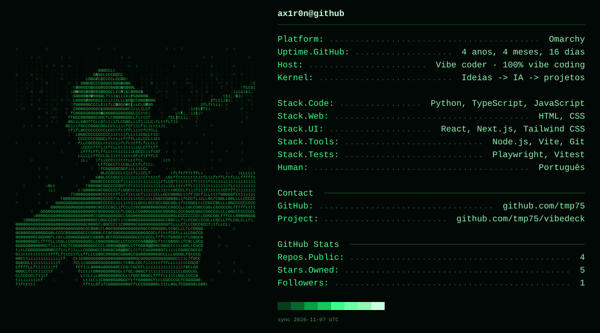

<!-- Generated by scripts/update_profile.py. Edit profile.json to customize. -->
<picture>
  <source media="(prefers-reduced-motion: reduce) and (max-width: 600px)" srcset="https://raw.githubusercontent.com/tmp75/tmp75/408bd048f79bf486f8909abe9e8244afafaae815/assets/neofetch-mobile-still.svg?v=90f560f9130b">
  <source media="(prefers-reduced-motion: reduce)" srcset="https://raw.githubusercontent.com/tmp75/tmp75/408bd048f79bf486f8909abe9e8244afafaae815/assets/neofetch-still.svg?v=4bd4fa6089af">
  <source media="(max-width: 600px)" srcset="https://raw.githubusercontent.com/tmp75/tmp75/408bd048f79bf486f8909abe9e8244afafaae815/assets/neofetch-mobile.svg?v=1a84c3226c52">
  
</picture>

[VibeDeck](https://github.com/tmp75/vibedeck)

<details>
<summary>Versão em texto</summary>

```text
ax1r0n@github
Platform: Omarchy
Uptime.GitHub: 4 anos, 4 meses, 17 dias
Host: Vibe coder · 100% vibe coding
Kernel: Ideias -> IA -> projetos
Stack.Code: Python, TypeScript, JavaScript
Stack.Web: HTML, CSS
Stack.UI: React, Next.js, Tailwind CSS
Stack.Tools: Node.js, Vite, Git
Stack.Tests: Playwright, Vitest
Human: Português
Contact
GitHub: github.com/tmp75
Project: github.com/tmp75/vibedeck
GitHub Stats
Repos.Public: 4
Stars.Owned: 5
Followers: 1
```

</details>
